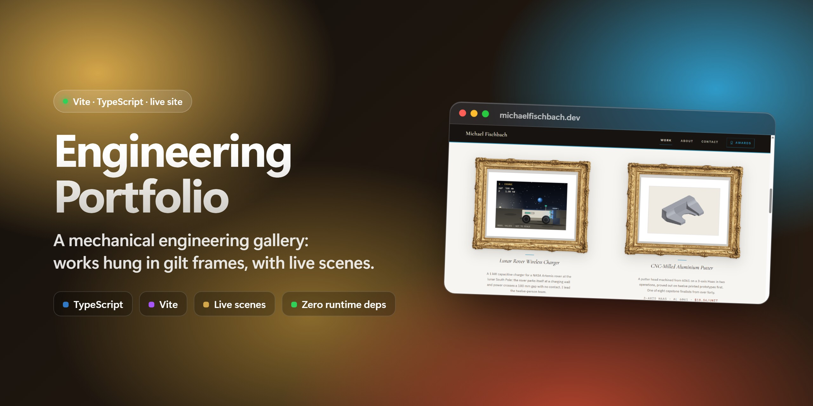
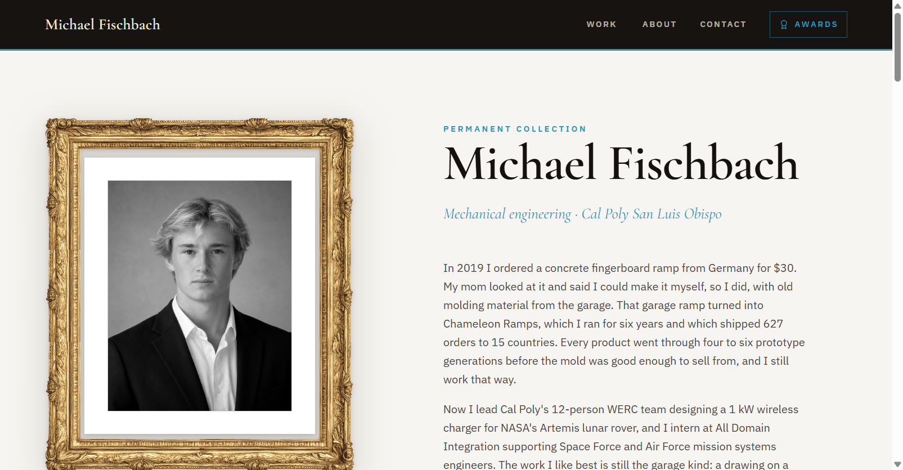
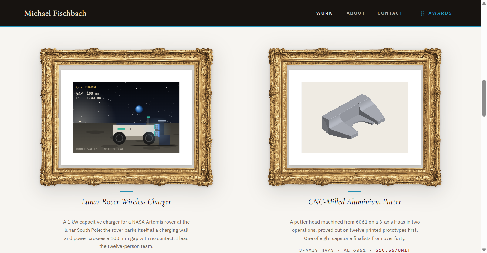

<a href="https://michaelfischbach.dev"></a>

<p align="center">
  <a href="https://michaelfischbach.dev"></a>
  
  
  <a href="https://github.com/whynobro/portfolio/actions/workflows/deploy.yml"></a>
  <a href="https://github.com/whynobro/portfolio/commits/main"></a>
</p>

<h3 align="center">An engineering portfolio hung like an art gallery.<br>Warm walls, gilt frames, serif captions, and a few things that move.</h3>

<p align="center">
  <a href="https://michaelfischbach.dev"><b>Visit michaelfischbach.dev</b></a>
  &nbsp;·&nbsp; <a href="#-features">Features</a>
  &nbsp;·&nbsp; <a href="#-getting-started">Getting started</a>
  &nbsp;·&nbsp; <a href="#-tech-stack">Tech stack</a>
  &nbsp;·&nbsp; <a href="#-project-layout">Layout</a>
</p>

The personal site of Michael Fischbach, a mechanical engineering student at Cal Poly San Luis Obispo. It is one page with hash-routed rooms: a landing wall, the eight works, an About room, an Awards room and Contact. Each work hangs in a photographed carved gilt frame with a serif caption, and a few of them run live scenes drawn right in the browser.

<p align="center"></p>

## ✨ Features

| | |
|---|---|
| 🖼️ **A gallery, not a template** | Works hang in a photographed carved frame (a CSS `border-image`) with cast shadows and serif captions on a warm off-white wall. |
| 🌙 **Live scenes** | The lunar-rover charging sequence and the CNC putter run as small canvas scenes on the wall and larger inside their rooms. |
| 🔩 **A real part, rendered live** | The putter's STL is a quantised mesh drawn by a z-buffered software rasteriser on a plain 2D canvas. Drag or use the arrow keys to turn it. |
| 🎮 **Two toys** | A ring toss with its own physics, and a tic-tac-toe engine that cannot lose. `npm run verify:ttt` proves it by exhaustive play. |
| 🧭 **Hash-routed rooms** | `#/work`, `#/about`, `#/awards`, `#/contact` and `#/work/<slug>`. No server rewrites needed, so it hosts anywhere static. |
| 📄 **Resume and CV buttons** | Download the one-page resume or the two-page CV as PDFs straight from the landing room. |
| 🪶 **Small shell** | The HTML shell stays under 100 KB (CI fails the build otherwise). Photographs ship as hashed, lazy-loaded assets, not inlined. |
| ♿ **Works without JS, respects reduced motion** | The wall carries every title, caption and figure in plain HTML. Scenes paint a full static frame under `prefers-reduced-motion`. |

<p align="center"></p>

## 🚀 Getting started

Node 22 is what CI uses.

```sh
git clone https://github.com/whynobro/portfolio.git
cd portfolio
npm ci
npm run dev        # Vite dev server with hot reload
```

| Command | What it does |
|---|---|
| `npm run dev` | Start the dev server |
| `npm run build` | Typecheck (`tsc --noEmit`), then build to `dist/` |
| `npm run preview` | Serve the production build locally |
| `npm run typecheck` | Typecheck only |
| `npm run verify:ttt` | Exhaustively prove the tic-tac-toe engine cannot lose |
| `npm run shots` | Capture every route with Playwright (needs the dev server running) |

Pushes to `main` run [the deploy workflow](.github/workflows/deploy.yml): install, typecheck, build, size and redirect checks, then publish to GitHub Pages. `public/CNAME` carries the custom domain.

## 🧱 Tech stack

| | |
|---|---|
| **Language** | TypeScript 5.7, no UI framework |
| **Build** | Vite 6, content-hashed assets, relative base so it works from any path |
| **Type** | Cormorant Garamond, IBM Plex Sans and IBM Plex Mono via Fontsource |
| **Imagery** | AVIF with JPEG fallback, prepared by `scripts/prep-images.mjs` (sharp) |
| **Scenes** | Hand-written canvas 2D, including a software mesh rasteriser |
| **Tooling** | Playwright for screenshots, `tsx` for scripts, `pdf-lib` for the resume PDFs |
| **Hosting** | GitHub Pages via GitHub Actions |

## 🗂️ Project layout

```text
index.html                 the only page: one [data-view] per room, static copy
src/main.ts                boot: awards, resume, projects, router, scenes
src/router.ts              hash routing, focus management, titles
src/projects.ts            the eight project rooms, rendered from data
src/awards.ts              the awards room
src/scenes/                putter, werc, tictactoe, ringtoss (lazy-mounted)
src/styles/                tokens, base, layout, frame, chrome, games, case
src/assets/                photographs, PDFs (hashed by the bundler)
public/                    CNAME, link-preview card, /general/ redirect
scripts/                   image, mesh and frame prep; resume generators; checks
```

## 📄 Credits

Built and written by [Michael Fischbach](https://michaelfischbach.dev). No license file is included in this repository, so all rights are reserved by default; ask before reusing the photographs, copy or design.
